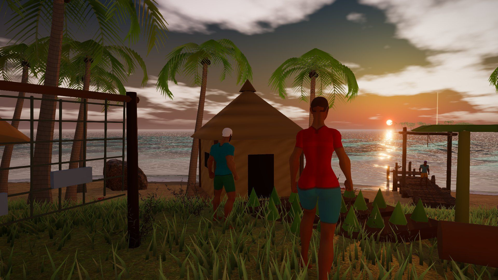
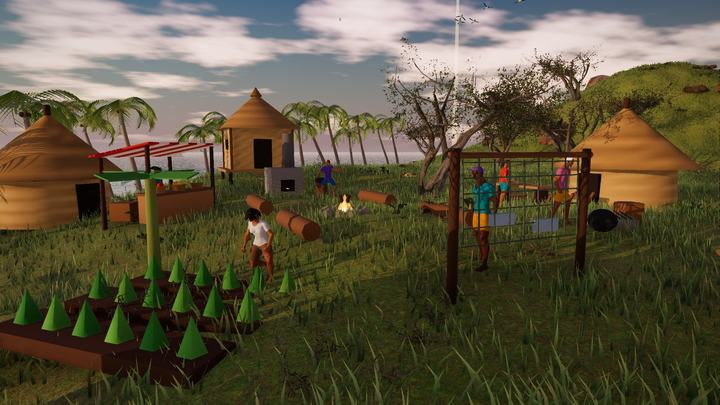
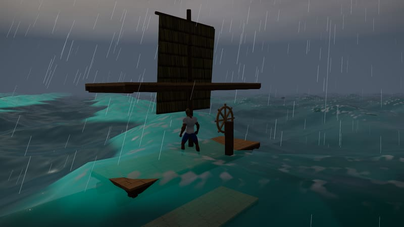
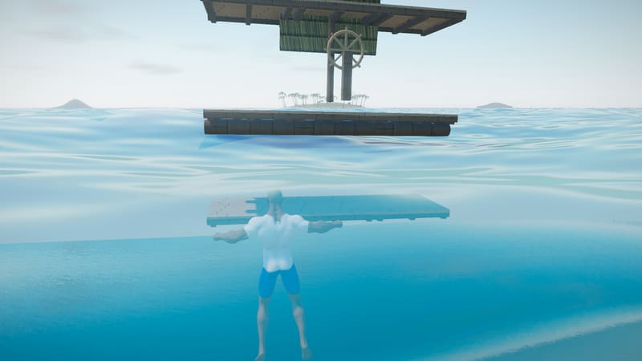
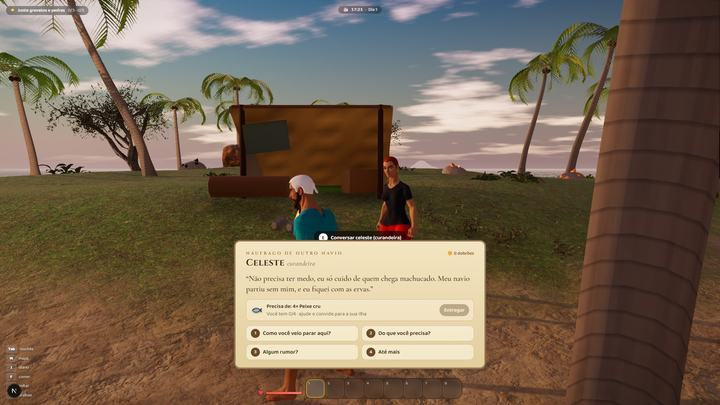
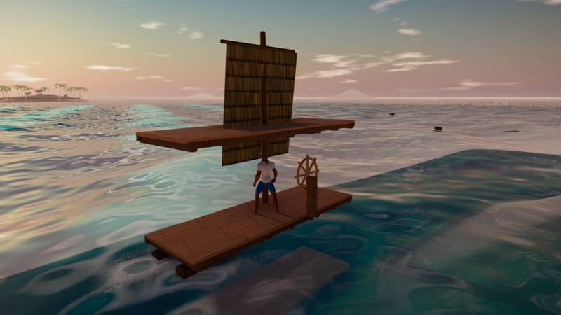
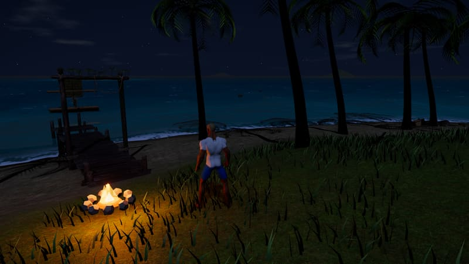

# Seventeen Tides · Dezessete Marés

*Dezessete partiram. Uma maré trouxe você de volta.*

Sobreviva ao naufrágio, construa sua jangada e navegue por um arquipélago sem fim atrás do tesouro secreto da sua tripulação.

 

&nbsp;

  

 

## A história

Dezessete piratas procuravam um tesouro secreto nestas ilhas. Na terceira noite veio a tempestade: um raio partiu o mastro e as ondas viraram o navio. **Dos dezessete, só você sobreviveu.**

Você acorda na areia. Os pertences dos seus companheiros vão chegando às praias, cada um com um pedaço da história, e alguns guardam pedaços do **mapa do capitão**.

 

## O que tem no jogo

<table>
<tr>
<td width="50%" valign="top">

**🏝️ Sobreviva e construa** 
Colete, cozinhe, monte ferramentas e uma jangada para ir cada vez mais longe.

**🌊 Um mar vivo** 
Cardumes, tartarugas, golfinhos e caranguejos. Dá para nadar, mergulhar no recife e escalar paredões.

**⛈️ Clima que muda a jogada** 
Tempestades em mar aberto, raios que caem perto de você, noites e pores do sol.

</td>
<td width="50%" valign="top">

**🗺️ O mapa do capitão** 
Siga os feixes de luz até os pertences da tripulação, junte o mapa e ache a Ilha do Tesouro Secreto.

**🏘️ Sua ilha vira vila** 
Resgate os sobreviventes de outros naufrágios. Eles constroem, plantam, comerciam e têm rotina própria.

**🏴‍☠️ Velas negras** 
Piratas atacam a vila ao entardecer e navios inimigos patrulham o mar aberto.

</td>
</tr>
</table>

 

## Imagens

<table>
<tr>
<td></td>
<td></td>
<td></td>
</tr>
<tr>
<td></td>
<td></td>
<td></td>
</tr>
</table>

 

## Instalação

1. Baixe o [instalador mais recente](https://github.com/vanngilha/seventeen-tides/releases/latest/download/SeventeenTides-Setup.exe).
2. Abra o arquivo e siga os passos.
3. Pronto. Depois de instalado, **o jogo se atualiza sozinho** e baixa só o que mudou.

> [!NOTE]
> Jogos independentes ainda sem certificado mostram o aviso "app desconhecido" do Windows. Clique em **Mais informações → Executar assim mesmo**.

Prefere não instalar? Há uma [prévia no navegador](https://ilha-tesouro.vercel.app/jogar).

 

## Feito com

-100f0d?style=flat-square&logo=rust&logoColor=d9a05b)

Este repositório guarda só os instaladores (veja em [Releases](https://github.com/vanngilha/seventeen-tides/releases)). O código do jogo não fica aqui.

 

**Curtiu? Deixe uma ⭐ para acompanhar as novidades.** 
Achou um bug ou tem uma ideia? [Abra uma issue](https://github.com/vanngilha/seventeen-tides/issues).

Feito em Ilhabela por [Christopher Oliveira](https://www.chrisoliveira.dev)

